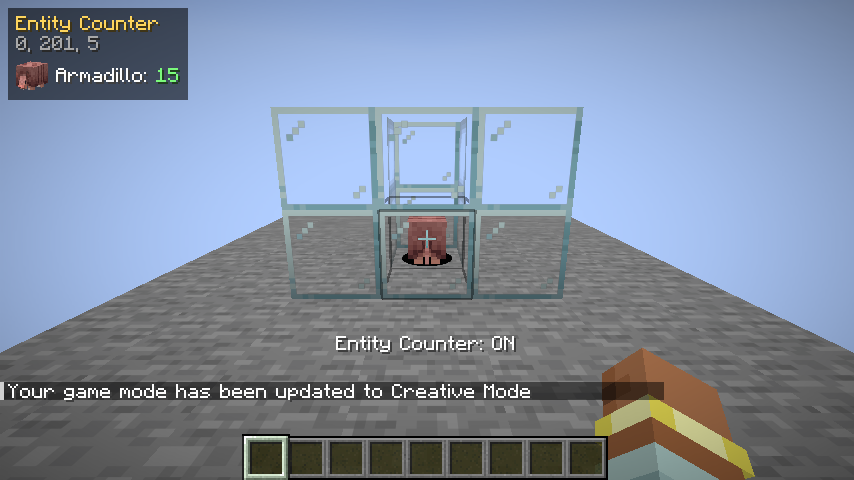
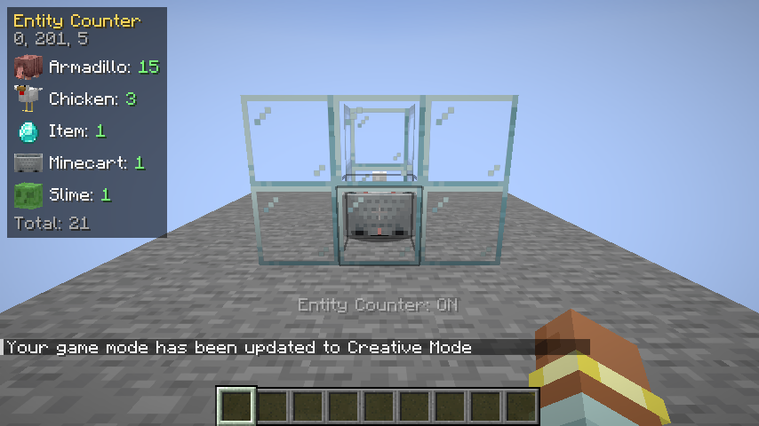

# Entity Counter

Client-side Fabric mod for Minecraft **1.21.11** that counts the entities standing in the block you are looking at.



## Why

Some farms need an exact number of mobs packed into a single 1x1 space - for example a slime farm that needs exactly 15 armadillos. Counting them by eye is impossible once they overlap. Entity Counter shows the number instantly.

## How to use

1. Press **F7** to turn the counter on or off.
2. Look at the block (or at a mob standing in it).
3. The panel in the top-left corner lists every entity type in that block with a picture, its name and how many there are.



The key can be changed under *Options → Controls → Key Binds → Entity Counter*.

## Details

- An entity belongs to the block its feet are in, so every entity is counted exactly once, even if its hitbox reaches into neighbouring blocks.
- Glass, fences, hoppers and other see-through blocks do not block the view, so you can count mobs inside a closed chamber.
- Works up to 32 blocks away.
- The panel hides while the F3 debug screen is open.
- Purely client-side: works on any server, nothing needs to be installed there.

## Requirements

- Minecraft 1.21.11
- [Fabric Loader](https://fabricmc.net/use/installer/) 0.19.2 or newer
- [Fabric API](https://modrinth.com/mod/fabric-api)

## Building

```
./gradlew build
```

The mod jar is written to `build/libs/`. `./gradlew runClientGameTest` starts a real client, builds a test chamber and checks the counts automatically.

## License

MIT
